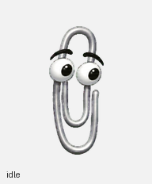

<p align="center"><strong>Clippy for Codex</strong></p>

A classic silver paperclip companion with expressive eyes, animated task states, and sixteen gaze directions.

Version **1.0.0** · transparent v2 pet package · Python 3 installer

<p align="center"><a href="https://github.com/Kian-hdr/clippy-codex-pet/releases/download/v1.0.0/Clippy_Codex_Pet_v1.0.0.zip">Download Clippy v1.0.0 — ZIP</a> · <a href="https://github.com/Kian-hdr/clippy-codex-pet/releases/download/v1.0.0/SHA256SUMS.txt">Checksums</a></p>

The package contains the complete pet assets, metadata, installer, documentation, and animated previews. The sprite format is platform-independent; runtime results must be checked in the user's Codex build. Python 3 is required for the installer.



[Lossless animated WebP](previews/all_states.webp) · [Lossless APNG](previews/all_states.apng) · [GIF](previews/all_states.gif) · [MP4](previews/Clippy_Animations.mp4) · [Gaze loop](previews/look_loop.gif)

## Install and select

Download the versioned ZIP and checksum file above. Quit Codex before running the selection command. Verify its SHA-256 checksum, extract it, and run from the extracted folder:

```sh
python3 install.py --select --size 192
```

**Quit Codex before using `--select` from a terminal**, so a running instance cannot overwrite the persisted selection. Reopen it afterward. Confirm **Clippy** is selected in the pet picker and appears correctly. The intended runtime identifier is `custom:clippy`.

To test with a separate configuration first:

```sh
python3 install.py --codex-home /path/to/isolated-codex-home --select --size 192
```

Run the Codex instance being tested with that same `CODEX_HOME`. An isolated file installation is not, by itself, proof that the running app discovered or selected the pet.

The installer preserves other pets and settings and refuses to replace a different existing `clippy` pet. Back up that pet before choosing to replace it. Do not copy credentials or account history into a test configuration.

Prefer asking Codex to handle setup? Copy the finished prompt in [SETUP_PROMPT.md](SETUP_PROMPT.md).

## What's included

- Nine standard states: idle/blink, rightward movement, leftward movement, greeting, jump/celebration, failure, waiting, active work/thinking, and review.
- Sixteen gaze poses, clockwise from up in 22.5-degree steps. These are attention directions, not a body turntable.
- A transparent v2 atlas, **1536 × 2288**, arranged as 8 × 11 cells of **192 × 208** pixels.
- All 73 required populated cells, with unused cells transparent.
- Metadata and motion previews for inspecting the complete set.

## Image quality

Use the lossless WebP or APNG previews to inspect the artwork; GIF has a limited palette and is a secondary preview format.

The inspected Codex build applies `image-rendering: pixelated` to pet sprites. Host sampling can make edges look jagged, especially when the fixed cell size is scaled. A 192-pixel display size avoids fractional downsampling relative to the source cell, but appearance still depends on display scaling and the app renderer. This is not a guarantee of smooth rendering on every display.

Do not enlarge the atlas to address this: the inspected v2 loader requires exactly 1536 × 2288. No app-bundle patch is required or included.

## Troubleshooting

**Clippy does not appear:** confirm that the running Codex instance uses the same `CODEX_HOME` as the installer. Check `pets/clippy/pet.json`, its `spriteVersionNumber: 2`, and its relative `spritesheetPath`. Reload the pet picker or restart Codex if necessary.

**Clippy installs but is not selected:** use the supported pet picker to select Clippy, then check the visible companion. A successful file copy is not selection evidence. Report the Codex version and installer output if automatic selection is unavailable.

**The image is rejected:** keep the atlas dimensions and transparent unused cells intact. Do not convert it to JPEG or remove the v2 metadata. Download a fresh release and verify its checksum.

**The installer refuses to replace a pet:** this protects an existing, different pet. Back it up or choose a separate `CODEX_HOME` before trying again. Do not delete other pets or reset the entire configuration.

**Edges look pixelated:** compare the lossless preview, try native 192-pixel display size, and check OS/display scaling. The app's own nearest-neighbor rendering remains a limitation. Please include a screenshot and Codex version in an issue.

**An animation or gaze looks wrong:** open the complete previews and identify the state or angle. Submit the affected frame and your Codex version through [Issues](https://github.com/Kian-hdr/clippy-codex-pet/issues).

## Validation

Tested with Codex **26.1103.31037 / build 25241** on macOS. Eight installer tests pass in temporary configurations, including backup/preservation, idempotence, conflict protection, invalid dimensions/paths and invalid selection sizes.

The documented CLI was executed in an isolated `CODEX_HOME`. The installed native loader discovered `custom:clippy`, and the native persistence code reloaded its selected ID and 192px width. This qualification uses filesystem/schema/logging adapters; it is not a claim that the entire desktop app was exercised.

All 57 standard frames and 16 gaze poses passed geometry/presence checks and independent visual review. A faint colored highlight remains in some wire pixels. Lossless full-color previews avoid the GIF palette restriction; the fixed atlas dimensions and host pixelated sampling remain unchanged.

A clean isolated desktop launch was also attempted. It reached the sign-in screen, so visible live picker selection and authenticated desktop playback remain unverified. No credentials were copied into the test configuration. See [validation summary](validation/summary.json) and [complete frame sheet](validation/contact_sheet.png).

## Attribution and rights

Clippy, also known as Clippit, is the Microsoft Office character originally designed by [Kevan Atteberry](https://www.kevanatteberry.com/). This is an independent, AI-generated fan recreation, not extracted Microsoft Office sprites. It is not affiliated with, sponsored by, or endorsed by Microsoft or OpenAI.

This is a free, non-commercial hobby project. That describes its intended use; it does not grant Microsoft character or trademark rights or establish that redistribution is cleared. See [ARTWORK_NOTICE.md](ARTWORK_NOTICE.md). The MIT license in [LICENSE_CODE](LICENSE_CODE) covers only this project's original installation code and documentation, not the character artwork or previews.

### Rights-holder requests

If you represent a rights holder and believe material should be removed, [open a GitHub issue](https://github.com/Kian-hdr/clippy-codex-pet/issues/new?title=Rights-holder%20removal%20request). Identify the material and the rights concerned. Removal requests will be reviewed promptly, and disputed material may be taken down while the matter is reviewed. Please do not post confidential legal documents in a public issue.
